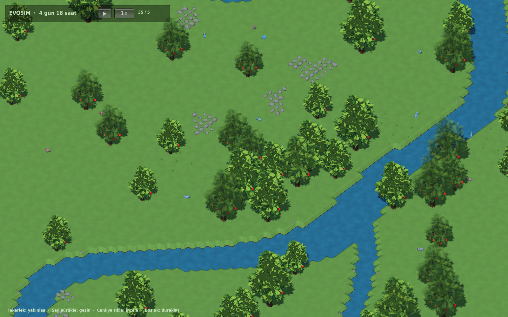

# EVOSIM

Kalıtsal karar ağıyla çalışan yapay yaşam simülasyonu. Bu depo 3 Ekim 2026 tarihli Unity 3D önizlemesini ve korunmuş C# simülasyon kaynaklarını içerir.

## Proje düzeni

- **EVOSIM-3D/Unity**: Unity 6000.3.24f1 / URP projesi.
- **EVOSIM-3D/blender**: düzenlenebilir modeller ve üretim betiği.
- **EVOSIM-3D/previews**: çalışan uygulama görüntüleri.
- **EVOSIM-3D/validation**: doğrulama sonuçları.
- **EVOSIM/src/EvoSim.Core**: Unity'den bağımsız biyoloji ve kalıtım çekirdeği.
- **EVOSIM/src/EvoSim.Observer**: SDL gözlemcisi; yayınlanmamış aday çalışmaları da içerir.
- **EVOSIM/docs/PLAN.md**: ayrıntılı yol haritası.

[3D önizleme, kontroller ve bilinen eksikler](EVOSIM-3D/README.md).

## Açma ve derleme

Unity Hub ile `EVOSIM-3D/Unity` klasörünü Unity 6000.3.24f1'de açın. `Assets/Scenes/CoreValidation.unity` sahnesini açıp Play kullanın. Editor menüsündeki `EVOSIM/Build Core validation scene` sahneyi yeniden oluşturur. Linux uygulaması `EvoSimSceneBuilder.BuildPlayer` Editor metodu ile derlenir.

Core kaynaklarını değiştirdikten sonra `dotnet build EVOSIM/src/EvoSim.Core -c Release` çalıştırın ve çıkan `EvoSim.Core.dll` dosyasını `EVOSIM-3D/Unity/Assets/Plugins/` konumuna kopyalayın. Unity projesinde doğrulanmış Core DLL bulunur.

Tam oyun göçü henüz bitmedi: Unity önizlemesinde dünya kitaplığı, kayıt/geri sarma ve çoklu gözlem panelleri açık işlerdir. Önizleme her açılışta ayrı bir deneme dünyası üretir.

