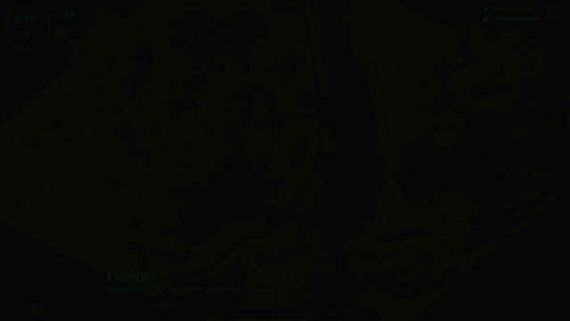
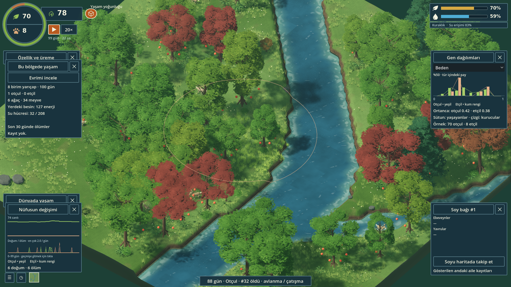

# EVOSIM

### Bir dünya kur. Nesiller boyunca nasıl değiştiğini keşfet.

EVOSIM, kendi koşullarını belirlediğin bir ekosistemde canlıların yaşamını, kalıtımını ve evrimini gözlemlediğin bir masaüstü simülasyonu. Bir nehri paylaşan otçullar ve avcılar, büyüyüp yaşlanan ormanlar, değişen kaynaklar ve nesiller arasında aktarılan özellikler… Her dünya, takip edebileceğin farklı bir hikâye oluşturur.

[](https://github.com/ozkurt23/EVOSIM/releases/download/preview-2026-10-25/evosim-12s.mp4)

**[▶ Tanıtımı izle / indir · 12 sn · 1080p · sessiz](https://github.com/ozkurt23/EVOSIM/blob/main/docs/media/evosim-12s.mp4)** · **[↓ Linux sürümünü indir](https://github.com/ozkurt23/EVOSIM/releases/download/preview-2026-10-25/EVOSIM-Linux-preview49-20261025.zip)** · **[Sürüm notları](https://github.com/ozkurt23/EVOSIM/releases/tag/preview-2026-10-25)**

*Geliştirilmekte olan, yerel çalışan bir önizleme. Hesap, abonelik veya uzak simülasyon sunucusu gerekmez. Tanıtım gerçek Godot sahnesinden düzenlenmiştir; performans ölçümü değildir.*

## Bu dünyada neler oluyor?

- **Nesiller değişiyor.** Bireylerin özellikleri ve karar ağı kalıtsal olarak aktarılır; mutasyonlar yeni çeşitlilik üretir. Hayatta kalma ve üreme, sonraki nesillerin dağılımını etkiler.
- **Kaynaklar hayatı şekillendiriyor.** Meyve, ot, su, enerji, avlanma ve üreme birbirine bağlıdır. Başlangıç nüfuslarını, gen aralıklarını ve mutasyon ayarlarını değiştirebilirsin.
- **Orman yaşıyor.** Ağaçlar filizlenir, büyür, meyve verir, yaşlanır ve ölür. Kuraklık, tohum yayılımı, yoğunluk ve çürümenin toprağa katkısı ormanın geleceğini etkiler.
- **Aynı harita farklı hikâyeler anlatıyor.** Rastgele tohum, harita ve kaynak ayarlarıyla farklı dünyalar kur; kendi sorularını dene.
- **Gözlem dünyanın üzerinde kalıyor.** Nüfus, besin ve ölüm katmanlarıyla nerede ne olduğunu gör. Canlıların aile bağlarını ve yaşayan soy üyelerini takip et.
- **Geçmiş kaybolmuyor.** Dünyalarını isimlendir, kaydet, geçmişe dön, o noktadan yeni bir dal oluştur ve kayıtlı dünyaların sonuçlarını karşılaştır.

Buradaki amaç bir skor tablosunda kazanmak değil: **“Bu koşullarda hangi özellikler yaygınlaşıyor; yaşam nerede yoğunlaşıyor; dünya neden değişiyor?”** sorularını araştırmak. EVOSIM deneysel bir yapay yaşam modelidir; gerçek doğanın bilimsel olarak doğrulanmış bir kopyası değildir. Birlikte değişen iki gösterge, tek başına neden-sonuç kanıtı sayılmaz.

## İndir ve çalıştır

### Linux x86_64 — hazır uygulama

1. **[Linux ZIP paketini indir](https://github.com/ozkurt23/EVOSIM/releases/download/preview-2026-10-25/EVOSIM-Linux-preview49-20261025.zip)** — yaklaşık 114 MB.
2. ZIP'i bir klasöre çıkar. İçindeki dosyaları birlikte tut; yalnızca çalıştırılabilir dosyayı başka yere taşıma.
3. Çıkan `EVOSIM-Linux` klasöründe `baslat.sh` dosyasını çalıştır.

Gerekirse o klasörde terminal aç:

```bash
chmod +x baslat.sh EVOSIM.x86_64
./baslat.sh
```

**Gerekenler:** Masaüstü Linux, x86_64 işlemci, Vulkan destekleyen ekran kartı ve güncel sürücü. Godot editörü, Blender, Python veya .NET SDK kurman gerekmez. İndirdikten sonra çevrimdışı oynayabilirsin.

**Windows / macOS:** Bu sürüm için doğrulanmış hazır paket henüz yok. Linux ZIP'i bu sistemlerde doğrudan çalışmaz.

> GitHub'daki **Code → Download ZIP**, geliştirme kaynaklarını indirir. Hazır uygulama için yukarıdaki **Linux sürümünü indir** bağlantısını kullan.

### İlk dünyanı keşfet

| Yapmak istediğin | Nereden? |
|---|---|
| Dünya oluşturmak | Ana menü → Yeni dünya; başlangıç için bir hazır ayar seç |
| Bir canlıyı tanımak | Canlıya tıkla; yaşam izi ve soy bağına bak |
| Bölgeyi anlamak | Haritada boş zemine tıkla |
| Nüfusun geçmişini görmek | Sol üstteki nüfus göstergesine tıkla |
| Belirli bir güne dönmek | Nüfus grafiğinde o güne tıkla |
| Bir ailenin yayılımını izlemek | Canlı → Soy bağı → Soyu haritada takip et |
| Kaynak/ölüm dağılımını görmek | Gözlem menüsündeki harita katmanlarını aç |
| İki deneyi karşılaştırmak | Ana menü → Karşılaştır; iki kayıtlı dünya seç |
| Hızlandırmak | Hız düğmesinden 20×'e kadar hedef hız seç |

Bir bilgi paneli açmak diğerini kapatmaz; paneller dört konumda katmanlanabilir. Sayısal göstergeler kadar dağılımlara, örnek sayılarına ve geçen zamana da bak: küçük nüfustaki değişimlerle büyük nüfustakiler aynı güvenle yorumlanamaz.



### Kayıtlar

Varsayılan Linux kayıt konumu: `~/.local/share/EVOSIM-Forest-v2/worlds` (özel XDG veri dizini kullanılıyorsa konum değişebilir). Uygulamayı güncellemeden önce kayıtlarını yedekle.

Eski `.evoworld` kayıtları için menüde **Eski dünyayı aktar** bulunur. Kaynak dosya korunur; yaşayan orman geçmişi aktarılan kaydın son gününden başlar. Model sürümleri arasında tarihsel uyumluluk kontrol edilir; eski kayıtların sessizce yeniden yorumlanması amaçlanmaz.

## Mevcut sürüm ve sınırlar

Bu depo artık **Godot 4 / Forward+ ve C# tabanlı yaşayan orman sürümünü** içeriyor. Önceki Unity çalışması tarihsel olarak korunuyor; güncel uygulamanın başlangıç noktası `EVOSIM-Godot`.

- 20× bir **hedef hızdır**. Dünya ağırlaştığında gerçekleşen hız düşebilir; hız göstergesinin açıklamasından görülebilir.
- Kısa yerel 1080p testinde, RTX 5090 **Laptop** GPU üzerinde 78 başlangıç canlısıyla ortanca kare süresi yaklaşık 14,6 ms (~69 FPS) ve gerçek simülasyon hızı yaklaşık 20× ölçüldü. Bu, tüm donanımlar veya kalabalık dünyalar için garanti değildir.
- Kalabalık dünyalar ve ilk kez görüntülenen bölgeler için optimizasyon sürüyor.
- Bazı uzun süreli testlerde hayvan nüfusları tükendi. Ekolojik denge ve çoklu tohum testleri geliştirme konusudur; canlıların her ayarda sonsuza kadar yaşayacağı vaat edilmez.
- Hazır paket aynı bilgisayarda temiz kullanıcı ortamında test edildi. Diğer Linux dağıtımları ve Windows/macOS için doğrulama tamamlanmadı.

[Doğrulama özeti](EVOSIM-Godot/validation/verification49.json) · [Performans çalışmaları](EVOSIM-Godot/docs/PERFORMANCE_RESEARCH.md) · [Yayın yol haritası](EVOSIM-Godot/docs/RELEASE_ROADMAP.md)

## Geliştiriciler için

**Mimari:** Sabit zaman adımlı C# simülasyonu, ayrı Godot görselleştirmesi, prosedürel arazi/bitki örtüsü, Blender varlıkları, yerel kayıt ve tekrar oynatma. Görüntü kare hızı ile biyolojik zaman birbirinden ayrıdır.

| Klasör | İçerik |
|---|---|
| `EVOSIM-Godot` | Güncel ortak Godot sahnesi, GDScript/C# köprüsü, shader'lar, özgün varlıklar ve doğrulamalar |
| `EVOSIM-Models/CoreV2` | Yaşayan ormanla bütünleşen simülasyon çekirdeği |
| `EVOSIM-Models/ForestEcology` | Ağaç yaşam döngüsü ve ekoloji |
| `EVOSIM-Models/V2Archive` | Sürüm kimliği, kayıt, geçmiş ve dallandırma |
| `EVOSIM-Models/v1` | Eski kayıt aktarımı için korunmuş özgün model |
| `EVOSIM/src` | Ortak gözlem araçları ve önceki çekirdek kaynakları |
| `EVOSIM-3D` | Önceki Unity prototipi |

Kaynak geliştirmesi için **Godot 4.7.2 .NET**, **.NET 10 SDK** ve **Python 3** kullanıldı. Blender yalnızca varlıkları yeniden üretmek için gerekir. Godot sürümüne ait NuGet paketleri ve lisansları `vendor/godot-nuget` içinde korunmuştur.

```bash
git clone https://github.com/ozkurt23/EVOSIM.git
cd EVOSIM
# Godot .NET çalıştırılabilir dosyanın konumunu belirt:
export EVOSIM_GODOT=/tam/yol/Godot_mono
bash EVOSIM-Godot/yasayan-orman.sh
```

`.NET` ve `python3` komutları PATH içinde olmalıdır. Başlatıcı, `EVOSIM-Godot-Forest` çalışma projesini ortak kaynaklardan üretir ve derler. Bu üretilmiş klasörü düzenlemek yerine `EVOSIM-Godot` kaynaklarını değiştir. İlk kaynak derlemesi paket geri yüklemesi için internet gerektirebilir.

## Görsel kimlik ve katkı

EVOSIM, sakin ve okunaklı bir minyatür ekosistem hissini hedefliyor. Terra Nil görsel araştırma referanslarından biridir; dağıtımda o oyunun varlıkları veya ekran görüntüleri kullanılmaz. Modeller ve dünya görselleri EVOSIM için üretilmiştir. Üçüncü taraf bileşenlerin lisansları hazır paketin `licenses` klasöründe yer alır.

Bir hata bildirirken dünya ayarlarını, varsa rastgele tohumu, işletim sistemi/GPU bilgisini ve sorunu yeniden oluşturan adımları ekle. Böylece görünen davranışın modelden mi, kayıttan mı yoksa çizimden mi kaynaklandığını ayırt etmek kolaylaşır.

---

**English:** EVOSIM is a local ecosystem and evolution sandbox with heritable agents, a living forest, configurable worlds, lineage tracking and time travel. The current playable preview is available for Linux x86_64. Download the release ZIP above; no editor or SDK is needed to run it.
